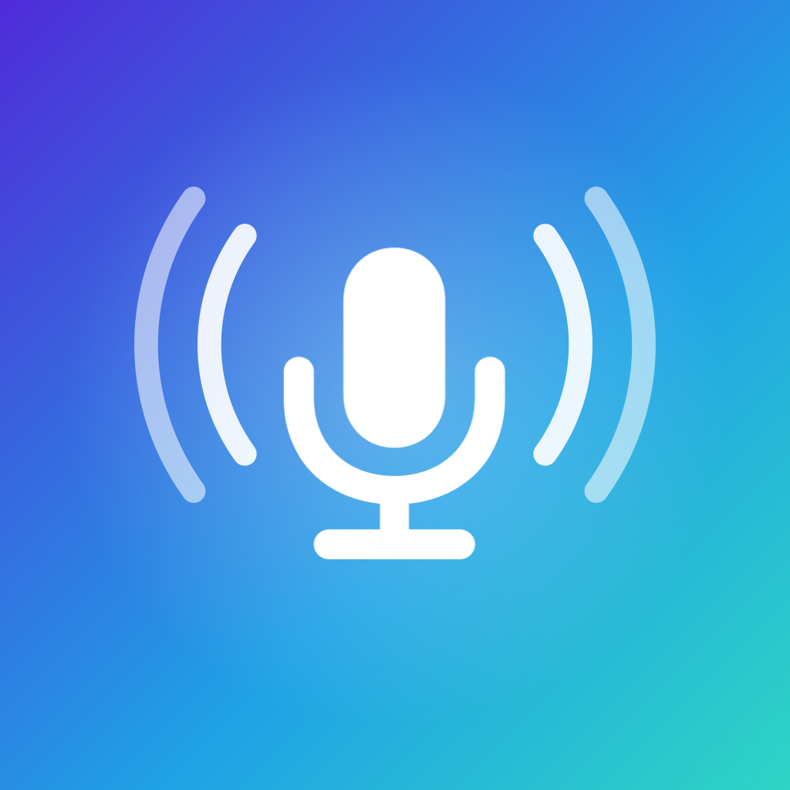

# Whisper Keyboard

[English](README.md) · [Português](README.pt-BR.md) · Español

Un teclado para iPhone que convierte tu voz en texto.

Las apps parecidas envían tu audio a los servidores de la empresa. Aquí la transcripción se hace en el propio iPhone, con Whisper: ningún audio ni texto sale del dispositivo, y no necesita cuenta. Entiende portugués, inglés y español, incluso mezclados en la misma frase.

## Cómo usarlo

* **Mantén pulsado** el botón del micrófono, habla y suelta: el texto aparece donde está el cursor, con puntuación y los espacios alrededor.
* O **toca** una vez, habla y vuelve a tocar para terminar. Mientras graba, la X cancela sin transcribir.
* Debajo están las teclas de puntuación, espacio, intro y borrar. El globo del iPhone cambia de teclado; para editar el texto, cambia al teclado del iPhone.

La app Whisper Keyboard tiene que seguir abierta, aunque sea en segundo plano, porque es la que escucha y transcribe; por eso el indicador de micrófono queda encendido. Tras el tiempo que eliges en la app, el micrófono se apaga solo. Si la app se cierra, toca el botón gris del micrófono: la app se abre y muestra cómo volver.

En la app también ves las últimas transcripciones en **Historial** (protegido con Face ID), eliges el modelo (Ligero, Equilibrado o Máximo), el idioma de entrada y un vocabulario de nombres y términos que Whisper debe escribir a tu manera.

## Instalar

1. En un Mac con **Xcode** y **XcodeGen** (`brew install xcodegen`), descarga este repositorio y ejecuta `xcodegen generate` en su carpeta.
2. Copia `Config/Local.xcconfig.example` a `Config/Local.xcconfig` y pon en él tu equipo de desarrollador (Xcode, **Settings, Accounts**) y un prefijo propio, como `com.tunombre`. Este archivo nunca se sube a GitHub.
3. Abre `WhisperKeyboard.xcodeproj`, conecta el iPhone, elígelo arriba en Xcode y pulsa **Run**. La primera vez, confía en el desarrollador en **Ajustes, General, VPN y gestión de dispositivos**.

La cuenta gratuita de desarrollador sirve, pero la app caduca a los pocos días; ejecútala de nuevo desde Xcode.

## Activar el teclado

1. En el iPhone, abre **Ajustes, Apps, Whisper, Teclados** y activa **Whisper Keyboard** y **Permitir acceso completo**.
2. Abre la app Whisper Keyboard una vez, permite el micrófono y espera a que se descargue el modelo (solo la primera vez; necesita internet).
3. En cualquier campo de texto, toca el globo y elige Whisper Keyboard.

El acceso completo es necesario porque el teclado habla con la app, que es la que tiene el micrófono. Aun así, nada sale del iPhone.

## Problemas frecuentes

* **El teclado no aparece o pide acceso completo:** revisa **Ajustes, Apps, Whisper, Teclados**.
* **El botón del micrófono está gris:** la app se cerró o el micrófono se apagó. Tócalo para abrir la app y vuelve deslizando hacia la derecha en la barra inferior.
* **Se queda en "Cargando el modelo":** la primera vez después de instalar, el iPhone prepara el modelo para su procesador, y eso puede tardar unos minutos.
* **El modelo no se descarga:** revisa la conexión y toca el modelo de nuevo.

## Privacidad

El audio nunca se guarda. El historial queda solo en el dispositivo, fuera de las copias de seguridad, y se puede desactivar. La app solo usa internet para descargar el modelo y buscar versiones más nuevas cuando lo pides. El texto copiado del Historial llega a tus otros dispositivos Apple y se borra del portapapeles a los pocos minutos.

## Licencia

Código abierto bajo la [licencia MIT](LICENSE). Desarrollado por Eberty Alves.
