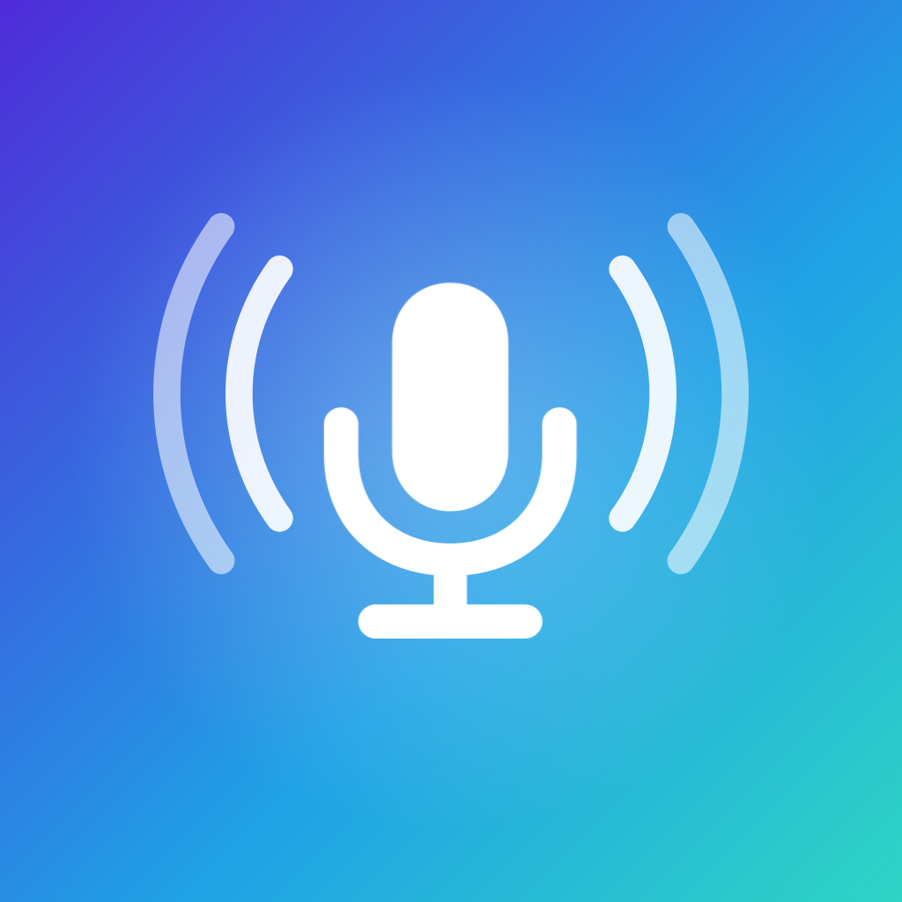

# Whisper Keyboard

English · [Português](README.pt-BR.md) · [Español](README.es.md)

An iPhone keyboard that turns your speech into text.

Similar apps send your audio to the company's servers. Here transcription runs on the iPhone itself, with Whisper: no audio or text ever leaves the device, and no account is needed. It understands Portuguese, English and Spanish, even mixed in the same sentence.

## How to use

* **Hold** the microphone button, speak and let go: the text appears at the cursor, with punctuation and the spaces around it.
* Or **tap** once, speak, and tap again to finish. While recording, the X cancels without transcribing.
* Below it are punctuation keys, space, return and delete. The iPhone's globe switches keyboards; to edit text, switch to the iPhone's keyboard.

The Whisper Keyboard app has to stay open, even in the background, because it is the one that listens and transcribes; that is why the microphone indicator stays on. After the time you choose in the app, the microphone turns itself off. If the app is closed, tap the gray microphone button: the app opens and shows how to go back.

In the app you can also see the latest transcriptions in **History** (protected by Face ID), choose the model (Light, Balanced or Best), the input language and a vocabulary of names and terms Whisper should spell your way.

## Install

1. On a Mac with **Xcode** and **XcodeGen** (`brew install xcodegen`), download this repository and run `xcodegen generate` in its folder.
2. Copy `Config/Local.xcconfig.example` to `Config/Local.xcconfig` and put in it your developer team (Xcode, **Settings, Accounts**) and a bundle prefix of your own, such as `com.yourname`. This file never goes to GitHub.
3. Open `WhisperKeyboard.xcodeproj`, connect the iPhone, pick it at the top of Xcode and click **Run**. The first time, trust the developer in **Settings, General, VPN & Device Management**.

A free developer account works, but the app expires after a few days; run it again from Xcode.

## Turn on the keyboard

1. On the iPhone, open **Settings, Apps, Whisper, Keyboards** and turn on **Whisper Keyboard** and **Allow Full Access**.
2. Open the Whisper Keyboard app once, allow the microphone and wait for the model to download (only the first time; it needs internet).
3. In any text field, tap the globe and choose Whisper Keyboard.

Full Access is needed because the keyboard talks to the app, which holds the microphone. Even so, nothing leaves the iPhone.

## Common problems

* **The keyboard is missing or asks for Full Access:** check **Settings, Apps, Whisper, Keyboards**.
* **The microphone button is gray:** the app was closed or the microphone turned off. Tap it to open the app, then swipe right on the bottom bar to go back.
* **It stays on "Loading model":** the first time after installing, the iPhone prepares the model for its processor, which can take a few minutes.
* **The model does not download:** check the connection and tap the model again.

## Privacy

Audio is never saved. History stays only on the device, outside backups, and can be turned off. The app uses the internet only to download the model and to look for newer versions when you ask. Text copied from History reaches your other Apple devices and is cleared from the clipboard after a few minutes.

## License

Open source under the [MIT license](LICENSE). Developed by Eberty Alves.
