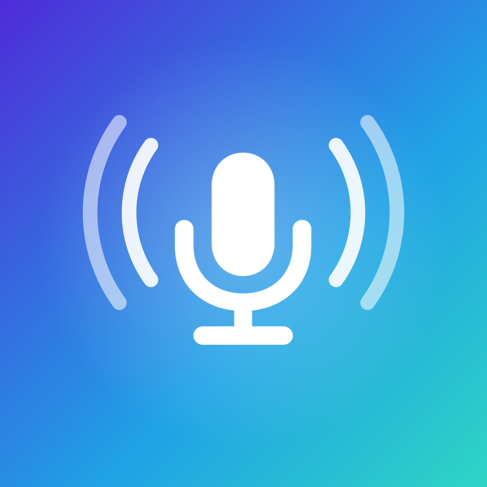

# Whisper Keyboard

[English](README.md) · Português · [Español](README.es.md)

Um teclado para iPhone que transforma sua fala em texto.

Os apps parecidos mandam seu áudio para os servidores da empresa. Aqui a transcrição é feita no próprio iPhone, com o Whisper: nenhum áudio ou texto sai do aparelho, e não precisa de conta. Entende português, inglês e espanhol, até misturados na mesma frase.

## Como usar

* **Segure** o botão do microfone, fale e solte: o texto aparece onde está o cursor, com pontuação e os espaços em volta.
* Ou **toque** uma vez, fale e toque de novo para terminar. Durante a gravação, o X cancela sem transcrever.
* Embaixo ficam as teclas de pontuação, o espaço, o enter e o apagar. O globo do iPhone troca de teclado; para editar o texto, troque para o teclado do iPhone.

O app Whisper Keyboard precisa ficar aberto, mesmo em segundo plano, porque é ele que escuta e transcreve; por isso o indicador de microfone fica aceso. Depois do tempo que você escolhe no app, o microfone desliga sozinho. Se o app for fechado, toque no botão cinza do microfone: o app abre e mostra como voltar.

No app você também vê as últimas transcrições no **Histórico** (protegido por Face ID), escolhe o modelo (Leve, Equilibrado ou Máximo), o idioma de entrada e um vocabulário de nomes e termos que o Whisper deve escrever do seu jeito.

## Instalar

1. Num Mac com **Xcode** e **XcodeGen** (`brew install xcodegen`), baixe este repositório e rode `xcodegen generate` na pasta dele.
2. Copie `Config/Local.xcconfig.example` para `Config/Local.xcconfig` e coloque nele o seu time de desenvolvedor (Xcode, **Settings, Accounts**) e um prefixo próprio, como `com.seunome`. Esse arquivo nunca vai para o GitHub.
3. Abra `WhisperKeyboard.xcodeproj`, conecte o iPhone, escolha-o no alto do Xcode e clique em **Run**. Na primeira vez, confie no desenvolvedor em **Ajustes, Geral, VPN e Gerenciamento de Dispositivos**.

A conta gratuita de desenvolvedor funciona, mas o app expira em poucos dias; rode de novo pelo Xcode.

## Ativar o teclado

1. No iPhone, abra **Ajustes, Apps, Whisper, Teclados** e ative **Whisper Keyboard** e **Permitir Acesso Total**.
2. Abra o app Whisper Keyboard uma vez, permita o microfone e espere o modelo baixar (só na primeira vez; precisa de internet).
3. Em qualquer campo de texto, toque no globo e escolha Whisper Keyboard.

O Acesso Total é necessário porque o teclado conversa com o app, que é quem tem o microfone. Mesmo assim, nada sai do iPhone.

## Problemas comuns

* **O teclado não aparece ou pede Acesso Total:** confira **Ajustes, Apps, Whisper, Teclados**.
* **O botão do microfone está cinza:** o app foi fechado ou o microfone desligou. Toque nele para abrir o app e volte deslizando para a direita na barra de baixo.
* **Fica em "Carregando o modelo":** na primeira vez depois de instalar, o iPhone prepara o modelo para o processador dele, o que pode levar alguns minutos.
* **O modelo não baixa:** confira a conexão e toque no modelo de novo.

## Privacidade

O áudio nunca é salvo. O Histórico fica só no aparelho, fora dos backups, e pode ser desligado. O app só usa a internet para baixar o modelo e procurar versões novas quando você pede. O texto copiado do Histórico chega aos seus outros aparelhos Apple e é apagado da área de transferência depois de alguns minutos.

## Licença

Código aberto sob a [licença MIT](LICENSE). Desenvolvido por Eberty Alves.
